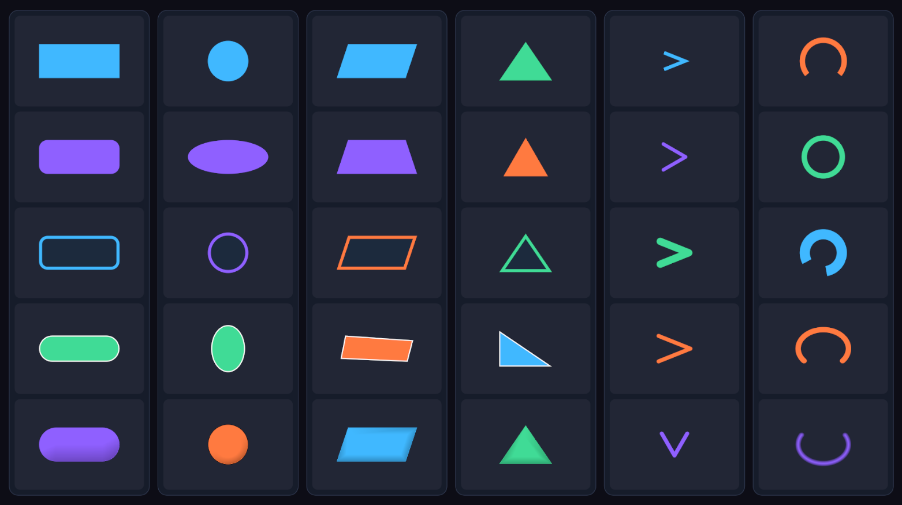

# SpriteLess UI

Geometry-based, sprite-free graphics for Unity uGUI.



## Requirements

- Unity 2021.3 LTS or newer
- Unity UI (`com.unity.ugui`) 1.0.0 or the version bundled with the Editor
- Git 2.14 or newer when installing from a Git URL

No TextMesh Pro, Scriptable Render Pipeline, generated texture, or custom shader dependency is required.

## Features

- Rounded Rectangle, Rectangle, and Pill
- Circle and Ellipse through RectTransform sizing
- Parallelogram, Trapezoid, and convex Quadrilateral through per-corner XY offsets
- Isosceles, Equilateral, and Right Triangle types
- Regular Polygon with 3–64 equal sides and clockwise rotation, fitted without stretching
- Chevron through Stretch or Equilateral proportions, direction, thickness, spread, cap, and join controls
- Ring and Arc through thickness, start angle, signed sweep angle, and cap style
- Individual corner radii
- Inside border with an anti-aliased inner edge
- Directional inset edge color for lightweight button and panel depth
- Inset geometry feather anti-aliasing that stays inside the shape bounds
- Screen Space Overlay, Mask, RectMask2D, Button, Slider, and Layout support
- RectTransform or shape-accurate raycast areas
- Shared default UI material and white texture
- RectTransform-based normalized UV mapping for custom UI materials

## Usage

Create an element from `GameObject > UI (Canvas) > SpriteLess`, or add a `SpriteLessImage` component to a UI GameObject.

`SpriteLessImage` exposes one Shape selector and the valid settings for that shape. Fill, border, edge effect, and anti-aliasing are generated as one CanvasRenderer mesh. Chevron uses one continuous stroke mesh and intentionally omits border and edge effect settings.

Equilateral Chevron preserves the proportions of two sides of an equilateral triangle while fitting inside the RectTransform.

Triangle supports RectTransform-filling Isosceles, fitted Equilateral, and four-corner Right Triangle layouts.

Regular Polygon uses `PolygonSides`, `PolygonRotation`, and `PolygonRadius` (default 0). The sharp base polygon keeps equal edges in non-square rectangles; Radius rounds its corners without moving its control vertices. Border, Edge Effect, AA and Shape Raycast follow the rounded perimeter. Radius is limited by the available edge length.

Enable **Center on Rect** (`PolygonCentered`) to keep the polygon center at the RectTransform center. Its circumradius is half the shorter rect dimension, so rotation keeps the same center and size, with possible extra space at the edges. Off (default) preserves the existing bounds-fit behavior. RectTransform pivot and size are not modified.

`MeshDetailScale` is a non-serialized capture hook (1–8). The default is 1; capture tools can increase it on temporary copies without changing saved/runtime defaults.

Every vertex uses RectTransform-normalized `uv0` coordinates from bottom-left `(0, 0)` to top-right `(1, 1)`.

Assign uGUI-compatible custom materials through the `Material` field in the SpriteLessImage Inspector.

Set `Raycast Area` to `Shape` for pointer input that follows non-rectangular geometry. The default `Rect Transform` option preserves standard uGUI behavior.

## Installation

Add the package from this Git URL:

```text
https://github.com/DarknessTyranno/SpriteLess-UI.git?path=/Packages/io.github.darknesstyranno.spriteless-ui
```

## License

MIT
